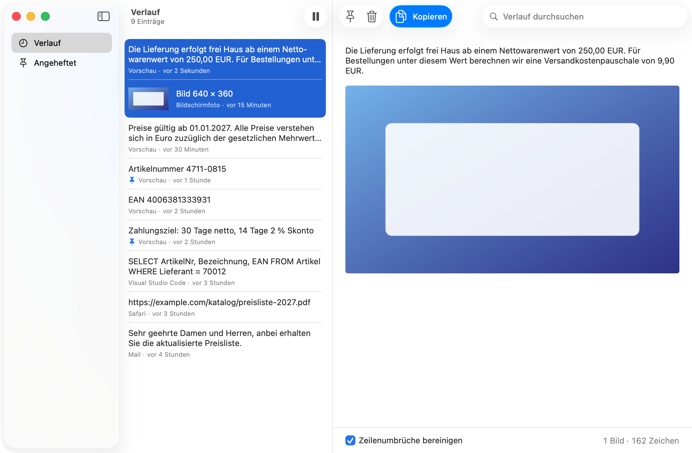

# Textsammler

macOS-App, die alles sammelt, was du kopierst: Texte, Bilder und Bildschirmfotos. Der Verlauf lässt sich durchsuchen, und mehrere Einträge lassen sich zu einem Text verknüpfen. Gedacht für Text, der stückweise aus PDFs kopiert wird.



## Funktionen

- **Sammeln:** Jeder kopierte Text landet automatisch im Verlauf, mit Quell-App und Zeit. Derselbe Text nochmal kopiert rückt nach oben, statt doppelt zu erscheinen.
- **Verknüpfen:** Mehrere Einträge mit Command-Klick wählen. Rechts steht der zusammengefügte Text in Kopierreihenfolge, getrennt durch Leerzeichen, Zeilenumbruch, Leerzeile oder nichts.
- **PDF-Bereinigung:** „Zeilenumbrüche bereinigen" macht aus PDF-Zeilen Fließtext und fügt am Zeilenende getrennte Wörter zusammen.
- **Bilder:** Kopierte Bilder und Bildschirmfotos aus der Zwischenablage werden mit Vorschau gespeichert und lassen sich wieder kopieren.
- **Bildschirmfoto-Dateien:** Auch Bildschirmfotos, die macOS als Datei sichert, erscheinen im Verlauf (gefunden über Spotlight). Die Datei bleibt, wo sie ist.
- **Anheften und Suchen:** Angeheftete Einträge überleben das Leeren des Verlaufs.
- **Menüleiste:** Das Symbol zeigt die letzten zehn Einträge, ein Klick kopiert. Die App sammelt weiter, wenn das Fenster zu ist.
- **Passwörter:** Was Passwortmanager als vertraulich markieren, wird nicht gespeichert.

## Voraussetzungen

macOS 26 oder neuer, Xcode 26 (Swift 6.2 oder neuer). Es gibt kein Xcode-Projekt, nur ein Swift-Paket.

## Bauen und starten

```bash
./build.sh --open
```

Das Skript baut, signiert (ad hoc, wenn kein Entwicklerzertifikat vorhanden ist) und installiert nach `~/Applications/Textsammler.app`.

Prüfen:

```bash
swift test --scratch-path ~/Library/Developer/Textsammler/test-build
tools/selftest.sh
tools/snap.sh
```

Für Bildschirmfoto-Dateien auf dem Schreibtisch fragt macOS beim ersten Mal nach dem Zugriff auf den Ordner. Bei ad hoc signierten Builds fragt es nach jedem Neubau erneut.

## Wo die Daten liegen

`~/Library/Application Support/Textsammler/Textsammler.store` (SwiftData), unverschlüsselt.

## Aufbau

- `Sources/Textsammler/` die App: `App.swift` (Fenster, Menüs, Menüleiste), `Models.swift` (Datenmodell, Zwischenablage-Überwachung, Aktionen), `ContentView.swift` (Oberfläche), `ImageTools.swift`.
- `Sources/TextsammlerKit/` Textlogik ohne SwiftUI (Bereinigen, Verknüpfen). Tests in `Tests/`.
- `CLAUDE.md` Regeln für das Arbeiten am Projekt mit Claude Code.

## Prompt zum Nachbauen mit Claude Code

Den folgenden Text in einer neuen Claude-Code-Sitzung in einem leeren Ordner einfügen:

```text
Baue mir eine native macOS-App „Textsammler" in SwiftUI mit SwiftData, als Swift-Paket
ohne Xcode-Projekt, für macOS 26. Oberfläche auf Deutsch. Ein Build-Skript soll die App
bauen, ad hoc signieren und nach ~/Applications installieren.

Zweck: Ich kopiere oft Text stückweise aus PDFs. Die App soll alles Kopierte sammeln,
die letzten Einträge zeigen und mehrere Einträge zu einem Text verknüpfen.

Sammeln
- Die Zwischenablage etwa alle 0,4 Sekunden über NSPasteboard.changeCount prüfen.
- Text speichern mit Quell-App (vorderste App) und Zeit. Derselbe Text nochmal kopiert
  erzeugt keinen zweiten Eintrag, sondern rückt nach oben. Leerer Text wird ignoriert.
- Einträge überspringen, die als vertraulich markiert sind (org.nspasteboard.ConcealedType,
  TransientType, AutoGeneratedType).
- Was die App selbst in die Zwischenablage legt, wird kein neuer Eintrag.
- Bilder aus der Zwischenablage (PNG oder TIFF) als PNG speichern, mit kleiner Vorschau,
  Pixelgröße und Prüfsumme gegen Dubletten. Hat die Zwischenablage Text und Bild, gewinnt
  der Text. Abschaltbar.
- Bildschirmfotos, die macOS als Datei sichert, ebenfalls aufnehmen: NSMetadataQuery mit
  kMDItemIsScreenCapture == 1 im Benutzerordner, nur Dateien, die nach dem App-Start
  entstanden sind. Die Datei bleibt liegen. Abschaltbar; bei fehlendem Ordnerzugriff ein
  Hinweis in den Einstellungen.
- Verlauf auf eine einstellbare Zahl begrenzen (Standard 200); angeheftete bleiben immer.
- Erfassung pausierbar.

Fenster
- Drei Spalten: Seitenleiste (Verlauf, Angeheftet), Liste, Detail.
- Liste: Einträge neueste zuerst, zweizeiliger Titel, darunter Quell-App und relative Zeit,
  Stecknadel bei angehefteten, Vorschaubild bei Bildern. Mehrfachauswahl, Suchfeld,
  Doppelklick kopiert, Rechtsklick-Menü.
- Detail: zeigt, was kopiert würde. Bei mehreren gewählten Einträgen der verknüpfte Text
  in Kopierreihenfolge (älteste zuerst), Bilder darunter. Fußleiste mit Option
  „Zeilenumbrüche bereinigen", Auswahl „Trennen mit" (Leerzeichen, Zeilenumbruch,
  Leerzeile, Nichts) und Zeichenzahl.
- Symbolleiste: Anheften, Löschen, „Als Eintrag sichern" (verknüpften Text als neuen
  Eintrag), „Kopieren" bzw. „Verknüpft kopieren" mit kurzer Bestätigung „Kopiert".

PDF-Bereinigung
- Zeilen innerhalb eines Absatzes zu einer Zeile verbinden, Leerzeilen trennen Absätze.
- Endet eine Zeile mit Bindestrich nach einem Buchstaben und beginnt die nächste klein,
  das Wort ohne Bindestrich zusammenfügen („Netto-" + „warenwert" = „Nettowarenwert").
- Mehrfache Leerzeichen zusammenfassen.

Sonstiges
- Menüleisten-Symbol mit den letzten zehn Einträgen (Klick kopiert), Fenster öffnen,
  Pausieren, Beenden. Fenster schließen beendet die App nicht.
- Einstellungen: Verlaufsgröße, Bilder sammeln, Bildschirmfoto-Dateien sammeln, beim
  Anmelden starten, Akzentfarbe.
- Jede Aktion hat einen Menübefehl mit Tastenkürzel (Umschalt-Command-C kopiert die
  Auswahl, Command-S sichert die Verknüpfung, Command-D heftet an).
- Textlogik in ein eigenes Modul ohne SwiftUI mit Unit-Tests. Ein Selbsttest (--selftest)
  prüft die Aktionen auf einer Test-Datenbank in /tmp, ohne die echte Zwischenablage zu
  überwachen.

Baue, starte die App und prüfe sie, bevor du fertig meldest.
```
